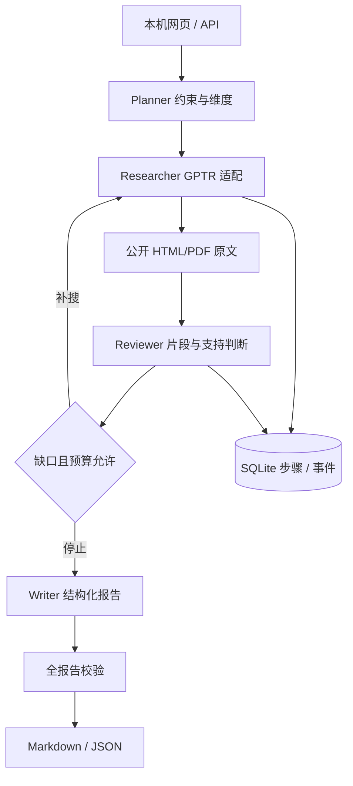

# 架构与边界

四种职责是流程角色，无需四个服务。研究/模型接口可替换；回放不执行真实研究。SQLite 先事务预留调用，完成立即保存 packet，旧状态保存不覆盖计数/步骤。进程重启标记中断，用户显式恢复；外部请求成功与保存之间仍有重复付费窗口。

来源 ID 为 URL＋正文哈希。quote 必须存在，语义 verdict 仅为模型判断。事实文本必须复用证据命题，建议和未知项不被自动认证。日期晚于截止日不能支持当时事实，日期未知必须披露；读取时间不是发布日期。当前读取器未可靠自动提取每个站点日期/版本，网页可能大量标为未知，不支持历史重建。

原文不作为指令，页面以文本展示。单进程本机运行，凭据只从环境加载。默认 3 轮/2 并发/8 外层调用，底座内部另设深度与搜索限制；不能换算金额硬预算。报告修复一次仍失败则保留失败任务，不能导出成功报告。

冻结实验比较给定材料下的规划/写作/核验；联网检索实验单列。SDK 替身测试不证明完整真实集成。具体用量缺项、数据集和人工协议见 evaluation.md。
